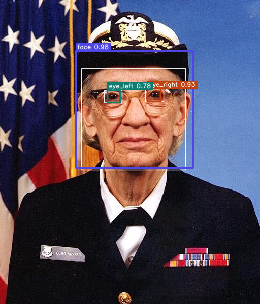

<p align="center"></p>

# Vision-Character-PoC

**Detects faces and eyes in an image, removes duplicate boxes, and scores the result against hand-labelled ground truth (precision, recall, F1), so "accuracy" is something you can show a client.**

[](LICENSE)


[日本語](README_JA.md)

## Use it

```bash
pip install -r requirements.txt     # opencv-python-headless 4.x (bundles the face/eye detectors)
python detect.py samples/grace_hopper.jpg --gt samples/grace_hopper.gt.json --draw out.png --json report.json
```

<p align="center"></p>

```text
| Class | TP | FP | FN | Precision | Recall | F1 (IoU>=0.5) |
| `eye_left`  | 1 | 0 | 0 | 1.000 | 1.000 | 1.000 |
| `eye_right` | 1 | 0 | 0 | 1.000 | 1.000 | 1.000 |
| `face`      | 1 | 0 | 0 | 1.000 | 1.000 | 1.000 |
```

Coloured boxes are detections, thin white boxes the hand-made labels. One photo is a demo, not a benchmark.

**Any other detector** (YOLO, a cloud API, a client's model): give its boxes as JSON and get the same filtering and
scoring, no OpenCV needed:
```bash
python detect.py image.jpg --pred their_boxes.json --gt labels.json
```
Box files: `[{"class": "face", "box": [x1, y1, x2, y2], "score": 0.9}, …]`. For ultralytics results,
`boxes_from_ultralytics(result)` converts directly.

## What is in here

| Part | File | Notes |
| :--- | :--- | :--- |
| Detector | `src/haar.py` | OpenCV Haar cascades for frontal faces, then eyes inside the upper face (at most one per side, at most 1/5 of the face wide). Scores are the cascade stage weight squashed to 0..1: good for ranking, not calibrated probabilities |
| Filtering | `src/detector.py` | Confidence threshold, per-class NMS |
| Evaluation | `src/detector.py` `evaluate()` | One-to-one matching per class at an IoU threshold, highest score first; a duplicate that survives NMS counts as a false positive |
| Reports | `DetectionReport.to_json()`, `metrics_markdown()` | JSON for systems, Markdown for people |

**Limits.** Haar cascades find frontal photographic faces. They do not work on anime characters or profiles; for
those, train a detector (for example YOLO on labelled character images) and plug its boxes in with `--pred`.
The evaluation layer is the same either way.

## Tests

```bash
python tests/test_detector.py
```
NMS and thresholds, JSON output, box validation, matching edge cases, the ultralytics adapter, the command line
with `--pred`, and real detection on the sample photo (when OpenCV is installed). GitHub Actions runs them on
Windows, macOS and Linux.

## Sample image

`samples/grace_hopper.jpg`: Commodore Grace M. Hopper, official U.S. Navy photograph, public domain.

## License

[MIT](LICENSE)
