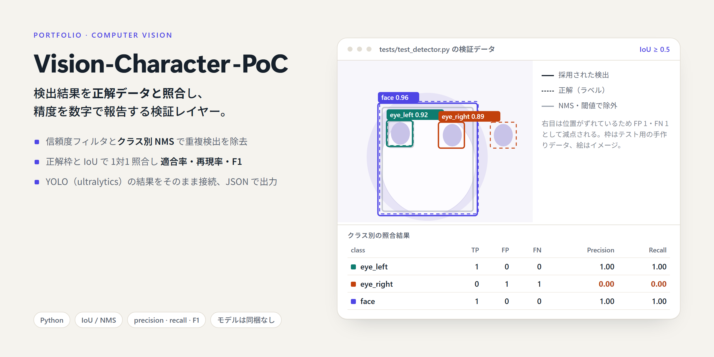

<p align="center"></p>

# Vision-Character-PoC: Detection Post-processing & Evaluation

<div align="center">

**Detector-agnostic NMS, structured reports, and precision / recall against ground truth**
*Per-class NMS · JSON + Markdown reports · TP / FP / FN · YOLO (ultralytics) adapter*

[](https://python.org)

</div>

---

## 1. What this is

Raw detector output is not something a client can sign off on. This repository is the layer
between a detector and a delivery report:

* **Filtering**: confidence threshold, then per-class IoU Non-Maximum Suppression.
* **Reports**: per-image JSON (`DetectionReport.to_json()`) and a Markdown summary of counts and confidence.
* **Evaluation**: `evaluate(predictions, ground_truth, iou_threshold=0.5)` matches boxes one-to-one per class
  (highest confidence first) and returns TP / FP / FN, precision, recall and F1, so "accuracy" means
  agreement with labelled boxes, not the model's own confidence.
* **Input validation**: inverted boxes or confidences outside 0..1 raise an error instead of producing silent nonsense.

**No model is bundled.** Plug in any detector; for ultralytics YOLO use the adapter:

```python
from ultralytics import YOLO          # pip install ultralytics
from detector import CharacterDetector, boxes_from_ultralytics, evaluate, metrics_markdown

result = YOLO("your-face-eye-model.pt")("character.png")[0]
report = CharacterDetector(0.5, 0.45).run_detection("character.png", boxes_from_ultralytics(result))
print(report.to_json())
print(metrics_markdown(evaluate(report.boxes, my_ground_truth_boxes)))
```

A face / eye model has to be trained or sourced separately (pretrained COCO weights have no face or eye class).

---

## 2. Tests

```bash
python tests/test_detector.py
```

Covers threshold + NMS, JSON output, box validation, matching edge cases (a misplaced box is one FP and
one FN; a duplicate that survives NMS is an FP, not a second hit) and the ultralytics adapter.

```markdown
| Class | TP | FP | FN | Precision | Recall | F1 (IoU>=0.5) |
| :--- | :---: | :---: | :---: | :---: | :---: | :---: |
| `eye_left` | 1 | 0 | 0 | 1.000 | 1.000 | 1.000 |
| `eye_right` | 0 | 1 | 1 | 0.000 | 0.000 | 0.000 |
| `face` | 1 | 0 | 0 | 1.000 | 1.000 | 1.000 |
```

The boxes in the tests are hand-made fixtures, not output from a real model.

---

## 3. License
MIT License.
