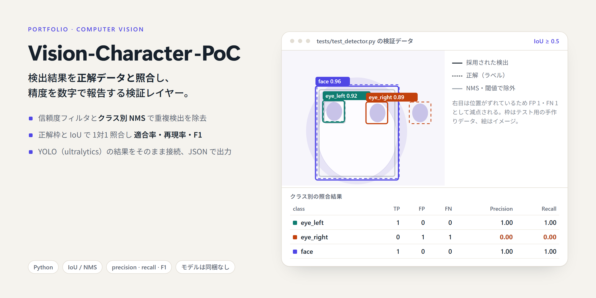
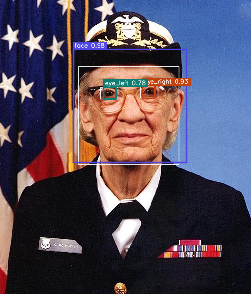

<p align="center"></p>

# Vision-Character-PoC

**画像から顔と目を検出し、重複を除いたうえで、手作業で付けた正解データと照合して適合率・再現率・F1 を出します。「精度」を数字でお客様に示すための検証ツールです。**


[English](README.md)

## 使い方

```bash
pip install -r requirements.txt     # opencv-python-headless 4.x（顔・目の検出器を同梱）
python detect.py samples/grace_hopper.jpg --gt samples/grace_hopper.gt.json --draw out.png --json report.json
```

<p align="center"></p>

色付きの枠が検出結果、白い細枠が正解ラベルです。写真 1 枚のデモであり、ベンチマークではありません。

**他の検出器の結果も評価できます**（YOLO、クラウド API、お客様のモデルなど）。枠を JSON で渡せば、OpenCV なしで同じ絞り込みと採点を行います:
```bash
python detect.py image.jpg --pred 他の検出結果.json --gt 正解.json
```
形式: `[{"class": "face", "box": [x1, y1, x2, y2], "score": 0.9}, …]`。ultralytics の結果は `boxes_from_ultralytics(result)` でそのまま変換できます。

## 構成

| 部分 | ファイル | 内容 |
| :--- | :--- | :--- |
| 検出 | `src/haar.py` | OpenCV の Haar カスケードで正面顔を検出し、顔の上部から目を探す（左右 1 つずつ、顔幅の 1/5 以下）。スコアはカスケードの段重みを 0〜1 に変換したもので、順位付け用（確率ではない） |
| 絞り込み | `src/detector.py` | 信頼度しきい値、クラス別 NMS |
| 評価 | `evaluate()` | クラスごとに IoU しきい値で 1 対 1 照合（スコアの高い順）。NMS をすり抜けた重複は誤検出として数える |
| レポート | `to_json()`、`metrics_markdown()` | システム向け JSON と、人が読む Markdown |

**制約:** Haar カスケードは正面を向いた実写の顔向けです。アニメのキャラクターや横顔には使えません。
その場合はラベル付き画像で検出器（例: YOLO）を学習させ、`--pred` で結果を渡してください。評価部分はそのまま使えます。

## テスト

```bash
python tests/test_detector.py
```
NMS としきい値、JSON 出力、枠の検証、照合の境界ケース、ultralytics 変換、`--pred` のコマンドライン、
サンプル写真での実際の検出（OpenCV がある場合）を確認します。GitHub Actions で Windows・macOS・Linux 上で実行しています。

## サンプル画像

`samples/grace_hopper.jpg`: グレース・ホッパー准将、米海軍の公式写真（パブリックドメイン）。

## ライセンス

[MIT](LICENSE)
